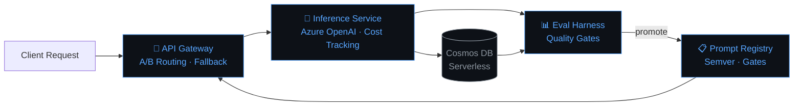

<div align="center">

[](https://github.com/sreenugopireddy)

[](https://github.com/sreenugopireddy)

</div>

---

```python
class Sreenu:
    role        = "AI / ML Engineer & Cloud Infrastructure Builder"
    education   = "B.Tech Data Science · Santhiram Engineering College (2023–2027)"
    location    = "Nandyal, Andhra Pradesh, India 🇮🇳"

    built = {
        "LLM Platform"   : "4-microservice Azure infra · Cosmos DB · GitHub Actions CI/CD",
        "Healthcare RAG" : "Domain-grounded QA pipeline · retrieval-augmented generation",
        "Eval Harness"   : "Semver prompt versioning · eval gates · deterministic A/B routing",
        "Anomaly Detect" : "Smart-grid energy demand forecasting + anomaly detection",
    }

    stack = {
        "AI/ML"  : ["LLMs", "RAG Pipelines", "LLM Evaluation", "Prompt Engineering"],
        "Cloud"  : ["Azure Container Apps", "Cosmos DB Serverless", "GCP Cloud Run"],
        "Dev"    : ["FastAPI", "Python", "Docker", "Bicep IaC"],
        "Data"   : ["Power BI", "SQL", "Pandas", "Jupyter"],
    }

    currently   = "Building FAANG-grade LLM systems · pursuing AI research opportunities"
    philosophy  = "Ship it, evaluate it, iterate relentlessly."
```

---

## ⚡ Flagship Project — Production LLM Platform on Azure

> A **FAANG-grade LLM infrastructure platform** built from scratch — four FastAPI microservices deployed to Azure Container Apps.

| Service | Responsibility |
|---|---|
| 🔀 **API Gateway** | Deterministic A/B routing · PTU-to-PAYG fallback |
| 🧠 **Inference Service** | Azure OpenAI (`gpt-4.1-mini`) · per-request cost chargeback |
| 📋 **Prompt Registry** | Semver prompt versioning · eval gates before promotion |
| 📊 **Eval Harness** | Automated evaluation · quality gates · metrics tracking |

**Live Gateway →** `llm-platform-gateway.greentree-67d78498.eastus.azurecontainerapps.io`
**Stack →** FastAPI · Azure Container Apps · Cosmos DB Serverless · Bicep IaC · GitHub Actions

### 🧭 How it works

A request hits the **API Gateway**, which applies deterministic A/B routing policy to select a prompt/model variant. The **Inference Service** calls Azure OpenAI, logs token usage and cost to **Cosmos DB**, and returns the response. Every prompt version lives in the **Prompt Registry** and must clear the **Eval Harness**'s quality gate before it's eligible for promotion to production traffic — so a bad prompt change never reaches real users.

### 🗺️ Architecture


## 🛠️ Tech Stack

<div align="center">


</div>

---

## 🎯 Core Focus Areas

| **`LLM Systems`** | **`Cloud Infrastructure`** | **`ML Engineering`** | **`Data & Analytics`** |
|---|---|---|---|
| Prompt versioning · Eval harnesses · A/B routing · Cost tracking | Azure · GCP · CI/CD · Containerization · Serverless | RAG Pipelines · Anomaly Detection · NLP | Power BI · SQL · Data modeling |

---

## 🔭 Now

- Building out the Eval Harness's automated regression suite for the LLM platform
- Reading up on retrieval quality metrics for the Healthcare RAG pipeline
- Applying to AI research / ML engineering internships for 2027

*(Update this section every few weeks — a live "now" signals momentum better than a static bio.)*

---

## 📜 Certifications

[](https://github.com/sreenugopireddy)
[](https://github.com/sreenugopireddy)
[](https://github.com/sreenugopireddy)
[](https://github.com/sreenugopireddy)
[](https://github.com/sreenugopireddy)
[](https://github.com/sreenugopireddy)

---

## 📊 GitHub Analytics

<div align="center">


[](https://git.io/streak-stats)

</div>

---

## 🤝 Let's Connect

<div align="center">

[](https://portfolio-pearl-nu-85.vercel.app/)
[](https://www.linkedin.com/in/sreenu-gopireddy/)
[](https://github.com/sreenugopireddy)

```
AI/ML Engineer · Cloud Infrastructure Builder · Open to Research & Internship Opportunities
If you're working at the frontier of LLM systems — let's build something.
```

</div>

[](https://github.com/sreenugopireddy)
